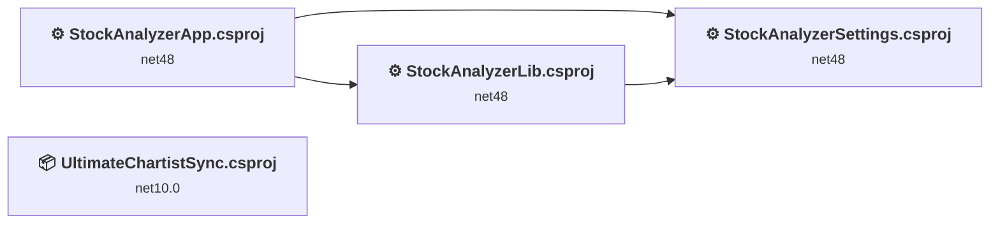
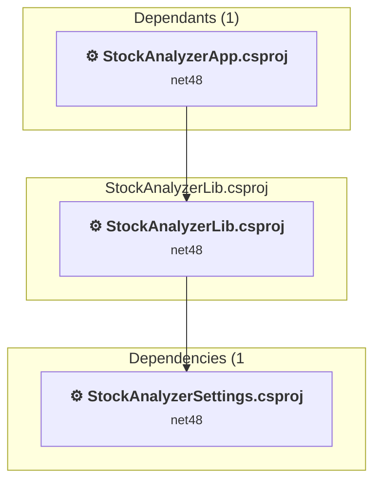
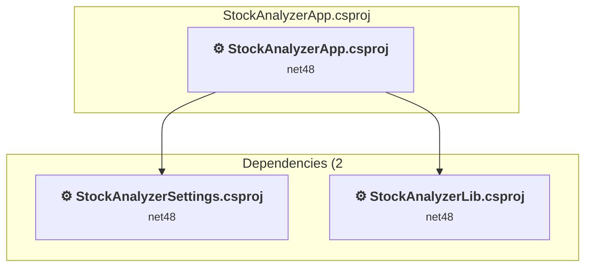
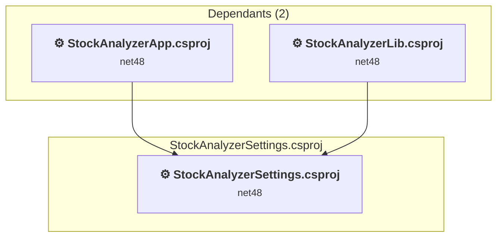
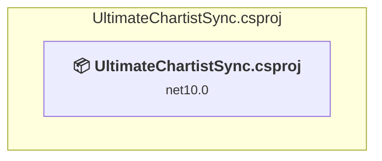

# Projects and dependencies analysis

This document provides a comprehensive overview of the projects and their dependencies in the context of upgrading to .NETCoreApp,Version=v10.0.

## Table of Contents

- [Executive Summary](#executive-Summary)
  - [Highlevel Metrics](#highlevel-metrics)
  - [Projects Compatibility](#projects-compatibility)
  - [Package Compatibility](#package-compatibility)
  - [API Compatibility](#api-compatibility)
  - [Binding Redirect Configuration](#binding-redirect-configuration)
- [Aggregate NuGet packages details](#aggregate-nuget-packages-details)
- [Top API Migration Challenges](#top-api-migration-challenges)
  - [Technologies and Features](#technologies-and-features)
  - [Most Frequent API Issues](#most-frequent-api-issues)
- [Projects Relationship Graph](#projects-relationship-graph)
- [Project Details](#project-details)

  - [StockAnalyzer\StockAnalyzerLib.csproj](#stockanalyzerstockanalyzerlibcsproj)
  - [StockAnalyzerApp\StockAnalyzerApp.csproj](#stockanalyzerappstockanalyzerappcsproj)
  - [StockAnalyzerSettings\StockAnalyzerSettings.csproj](#stockanalyzersettingsstockanalyzersettingscsproj)
  - [UltimateChartistSync\UltimateChartistSync.csproj](#ultimatechartistsyncultimatechartistsynccsproj)

## Executive Summary

### Highlevel Metrics

| Metric | Count | Status |
| :--- | :---: | :--- |
| Total Projects | 4 | 3 require upgrade |
| Total NuGet Packages | 34 | 8 need upgrade |
| Total Code Files | 601 |  |
| Total Code Files with Incidents | 345 |  |
| Total Lines of Code | 77472 |  |
| Total Number of Issues | 17188 |  |
| Estimated LOC to modify | 17082+ | at least 22.0% of codebase |

### Projects Compatibility

| Project | Target Framework | Difficulty | Package Issues | API Issues | Binding Issues | Est. LOC Impact | Description |
| :--- | :---: | :---: | :---: | :---: | :---: | :---: | :--- |
| [StockAnalyzer\StockAnalyzerLib.csproj](#stockanalyzerstockanalyzerlibcsproj) | net48 | 🟡 Medium | 21 | 2535 | 28 | 2535+ | ClassicWpf, Sdk Style = False |
| [StockAnalyzerApp\StockAnalyzerApp.csproj](#stockanalyzerappstockanalyzerappcsproj) | net48 | 🟡 Medium | 18 | 14460 | 32 | 14460+ | ClassicWpf, Sdk Style = False |
| [StockAnalyzerSettings\StockAnalyzerSettings.csproj](#stockanalyzersettingsstockanalyzersettingscsproj) | net48 | 🟢 Low | 0 | 87 | 1 | 87+ | ClassicClassLibrary, Sdk Style = False |
| [UltimateChartistSync\UltimateChartistSync.csproj](#ultimatechartistsyncultimatechartistsynccsproj) | net10.0 | ✅ None | 0 | 0 | 0 |  | WinForms, Sdk Style = True |

### Package Compatibility

| Status | Count | Percentage |
| :--- | :---: | :---: |
| ✅ Compatible | 26 | 76.5% |
| ⚠️ Incompatible | 0 | 0.0% |
| 🔄 Upgrade Recommended | 8 | 23.5% |
| ***Total NuGet Packages*** | ***34*** | ***100%*** |

### API Compatibility

| Category | Count | Impact |
| :--- | :---: | :--- |
| 🔴 Binary Incompatible | 13372 | High - Require code changes |
| 🟡 Source Incompatible | 3580 | Medium - Needs re-compilation and potential conflicting API error fixing |
| 🔵 Behavioral change | 130 | Low - Behavioral changes that may require testing at runtime |
| ✅ Compatible | 128528 |  |
| ***Total APIs Analyzed*** | ***145610*** |  |

### Binding Redirect Configuration

| Severity | Count | Description |
| :--- | :---: | :--- |
| 🔴Mandatory | 13 | Must be fixed to avoid runtime failures |
| 🟡Potential | 48 | May cause issues in certain scenarios |
| ***Total Binding Issues*** | ***61*** | ***Across 3 project(s)*** |

## Aggregate NuGet packages details

| Package | Current Version | Suggested Version | Projects | Description |
| :--- | :---: | :---: | :--- | :--- |
| Autofac | 9.0.0 |  | [StockAnalyzerApp.csproj](#stockanalyzerappstockanalyzerappcsproj) | ✅Compatible |
| ExcelDataReader | 3.8.0 |  | [StockAnalyzerLib.csproj](#stockanalyzerstockanalyzerlibcsproj) | ✅Compatible |
| HtmlAgilityPack | 1.12.4 |  | [StockAnalyzerLib.csproj](#stockanalyzerstockanalyzerlibcsproj) | ✅Compatible |
| Microsoft.Bcl.AsyncInterfaces | 10.0.2 | 10.0.13 | [StockAnalyzerApp.csproj](#stockanalyzerappstockanalyzerappcsproj) [StockAnalyzerLib.csproj](#stockanalyzerstockanalyzerlibcsproj) | NuGet package upgrade is recommended |
| Microsoft.Bcl.TimeProvider | 10.0.2 | 10.0.13 | [StockAnalyzerLib.csproj](#stockanalyzerstockanalyzerlibcsproj) | NuGet package upgrade is recommended |
| Microsoft.CSharp | 4.7.0 |  | [StockAnalyzerApp.csproj](#stockanalyzerappstockanalyzerappcsproj) | ✅Compatible |
| Microsoft.Extensions.DependencyInjection.Abstractions | 10.0.2 | 10.0.13 | [StockAnalyzerLib.csproj](#stockanalyzerstockanalyzerlibcsproj) | NuGet package upgrade is recommended |
| Microsoft.Extensions.Logging.Abstractions | 10.0.2 | 10.0.13 | [StockAnalyzerLib.csproj](#stockanalyzerstockanalyzerlibcsproj) | NuGet package upgrade is recommended |
| Microsoft.Identity.Client | 4.81.0 |  | [UltimateChartistSync.csproj](#ultimatechartistsyncultimatechartistsynccsproj) | ✅Compatible |
| Microsoft.IdentityModel.Abstractions | 8.14.0 |  | [UltimateChartistSync.csproj](#ultimatechartistsyncultimatechartistsynccsproj) | ✅Compatible |
| Microsoft.IdentityModel.Abstractions | 8.15.0 |  | [StockAnalyzerLib.csproj](#stockanalyzerstockanalyzerlibcsproj) | ✅Compatible |
| Microsoft.IdentityModel.Logging | 8.15.0 |  | [StockAnalyzerLib.csproj](#stockanalyzerstockanalyzerlibcsproj) | ✅Compatible |
| Microsoft.IdentityModel.Tokens | 8.15.0 |  | [StockAnalyzerLib.csproj](#stockanalyzerstockanalyzerlibcsproj) | ✅Compatible |
| Newtonsoft.Json | 13.0.4 |  | [StockAnalyzerApp.csproj](#stockanalyzerappstockanalyzerappcsproj) [StockAnalyzerLib.csproj](#stockanalyzerstockanalyzerlibcsproj) | ✅Compatible |
| System.Buffers | 4.6.1 |  | [StockAnalyzerApp.csproj](#stockanalyzerappstockanalyzerappcsproj) [StockAnalyzerLib.csproj](#stockanalyzerstockanalyzerlibcsproj) | NuGet package functionality is included with framework reference |
| System.Collections | 4.3.0 |  | [StockAnalyzerApp.csproj](#stockanalyzerappstockanalyzerappcsproj) | NuGet package functionality is included with framework reference |
| System.Diagnostics.DiagnosticSource | 10.0.2 | 10.0.13 | [StockAnalyzerApp.csproj](#stockanalyzerappstockanalyzerappcsproj) [StockAnalyzerLib.csproj](#stockanalyzerstockanalyzerlibcsproj) | NuGet package upgrade is recommended |
| System.IO | 4.3.0 |  | [StockAnalyzerApp.csproj](#stockanalyzerappstockanalyzerappcsproj) [StockAnalyzerLib.csproj](#stockanalyzerstockanalyzerlibcsproj) | NuGet package functionality is included with framework reference |
| System.IO.Pipelines | 10.0.2 | 10.0.13 | [StockAnalyzerApp.csproj](#stockanalyzerappstockanalyzerappcsproj) [StockAnalyzerLib.csproj](#stockanalyzerstockanalyzerlibcsproj) | NuGet package upgrade is recommended |
| System.Memory | 4.6.3 |  | [StockAnalyzerApp.csproj](#stockanalyzerappstockanalyzerappcsproj) [StockAnalyzerLib.csproj](#stockanalyzerstockanalyzerlibcsproj) | NuGet package functionality is included with framework reference |
| System.Net.Http | 4.3.4 |  | [StockAnalyzerApp.csproj](#stockanalyzerappstockanalyzerappcsproj) [StockAnalyzerLib.csproj](#stockanalyzerstockanalyzerlibcsproj) | NuGet package functionality is included with framework reference |
| System.Numerics.Vectors | 4.6.1 |  | [StockAnalyzerApp.csproj](#stockanalyzerappstockanalyzerappcsproj) [StockAnalyzerLib.csproj](#stockanalyzerstockanalyzerlibcsproj) | NuGet package functionality is included with framework reference |
| System.Reflection.TypeExtensions | 4.7.0 |  | [StockAnalyzerApp.csproj](#stockanalyzerappstockanalyzerappcsproj) | NuGet package functionality is included with framework reference |
| System.Runtime | 4.3.1 |  | [StockAnalyzerApp.csproj](#stockanalyzerappstockanalyzerappcsproj) [StockAnalyzerLib.csproj](#stockanalyzerstockanalyzerlibcsproj) | NuGet package functionality is included with framework reference |
| System.Runtime.CompilerServices.Unsafe | 6.1.2 |  | [StockAnalyzerApp.csproj](#stockanalyzerappstockanalyzerappcsproj) [StockAnalyzerLib.csproj](#stockanalyzerstockanalyzerlibcsproj) | ✅Compatible |
| System.Security.Cryptography.Algorithms | 4.3.1 |  | [StockAnalyzerApp.csproj](#stockanalyzerappstockanalyzerappcsproj) [StockAnalyzerLib.csproj](#stockanalyzerstockanalyzerlibcsproj) | NuGet package functionality is included with framework reference |
| System.Security.Cryptography.Encoding | 4.3.0 |  | [StockAnalyzerApp.csproj](#stockanalyzerappstockanalyzerappcsproj) [StockAnalyzerLib.csproj](#stockanalyzerstockanalyzerlibcsproj) | NuGet package functionality is included with framework reference |
| System.Security.Cryptography.Primitives | 4.3.0 |  | [StockAnalyzerApp.csproj](#stockanalyzerappstockanalyzerappcsproj) [StockAnalyzerLib.csproj](#stockanalyzerstockanalyzerlibcsproj) | NuGet package functionality is included with framework reference |
| System.Security.Cryptography.X509Certificates | 4.3.2 |  | [StockAnalyzerApp.csproj](#stockanalyzerappstockanalyzerappcsproj) [StockAnalyzerLib.csproj](#stockanalyzerstockanalyzerlibcsproj) | NuGet package functionality is included with framework reference |
| System.Text.Encoding | 4.3.0 |  | [StockAnalyzerLib.csproj](#stockanalyzerstockanalyzerlibcsproj) | NuGet package functionality is included with framework reference |
| System.Text.Encodings.Web | 10.0.2 | 10.0.13 | [StockAnalyzerLib.csproj](#stockanalyzerstockanalyzerlibcsproj) | NuGet package upgrade is recommended |
| System.Text.Json | 10.0.2 | 10.0.13 | [StockAnalyzerApp.csproj](#stockanalyzerappstockanalyzerappcsproj) [StockAnalyzerLib.csproj](#stockanalyzerstockanalyzerlibcsproj) | NuGet package upgrade is recommended |
| System.Threading.Tasks.Extensions | 4.6.3 |  | [StockAnalyzerApp.csproj](#stockanalyzerappstockanalyzerappcsproj) [StockAnalyzerLib.csproj](#stockanalyzerstockanalyzerlibcsproj) | NuGet package functionality is included with framework reference |
| System.ValueTuple | 4.6.1 |  | [StockAnalyzerApp.csproj](#stockanalyzerappstockanalyzerappcsproj) [StockAnalyzerLib.csproj](#stockanalyzerstockanalyzerlibcsproj) | NuGet package functionality is included with framework reference |

## Top API Migration Challenges

### Technologies and Features

| Technology | Issues | Percentage | Migration Path |
| :--- | :---: | :---: | :--- |
| Windows Forms | 11682 | 68.4% | Windows Forms APIs for building Windows desktop applications with traditional Forms-based UI that are available in .NET on Windows. Enable Windows Desktop support: Option 1 (Recommended): Target net9.0-windows; Option 2: Add <UseWindowsDesktop>true</UseWindowsDesktop>; Option 3 (Legacy): Use Microsoft.NET.Sdk.WindowsDesktop SDK. |
| GDI+ / System.Drawing | 3435 | 20.1% | System.Drawing APIs for 2D graphics, imaging, and printing that are available via NuGet package System.Drawing.Common. Note: Not recommended for server scenarios due to Windows dependencies; consider cross-platform alternatives like SkiaSharp or ImageSharp for new code. |
| WPF (Windows Presentation Foundation) | 460 | 2.7% | WPF APIs for building Windows desktop applications with XAML-based UI that are available in .NET on Windows. WPF provides rich desktop UI capabilities with data binding and styling. Enable Windows Desktop support: Option 1 (Recommended): Target net9.0-windows; Option 2: Add <UseWindowsDesktop>true</UseWindowsDesktop>. |
| Windows Forms Legacy Controls | 148 | 0.9% | Legacy Windows Forms controls that have been removed from .NET Core/5+ including StatusBar, DataGrid, ContextMenu, MainMenu, MenuItem, and ToolBar. These controls were replaced by more modern alternatives. Use ToolStrip, MenuStrip, ContextMenuStrip, and DataGridView instead. |
| Legacy Configuration System | 86 | 0.5% | Legacy XML-based configuration system (app.config/web.config) that has been replaced by a more flexible configuration model in .NET Core. The old system was rigid and XML-based. Migrate to Microsoft.Extensions.Configuration with JSON/environment variables; use System.Configuration.ConfigurationManager NuGet package as interim bridge if needed. |
| CodeDom & Dynamic Code Generation | 34 | 0.2% | Runtime code generation, compilation, and scripting APIs including CodeDom and JScript that have limited support in .NET Core/.NET. These were used for dynamic code generation but are largely obsolete. Consider Roslyn APIs for code generation or alternative scripting solutions. |
| ClickOnce Deployment | 6 | 0.0% | ClickOnce deployment technology for distributing Windows applications that is not available on .NET Core. Use alternative deployment methods such as self-contained deployments, Windows Package Manager, or third-party installers like WiX or InstallShield. |
| System Management (WMI) | 6 | 0.0% | Windows Management Instrumentation (WMI) APIs for system administration and monitoring that are available via NuGet package System.Management. These APIs provide access to Windows system information but are Windows-only; consider cross-platform alternatives for new code. |
| Legacy Cryptography | 1 | 0.0% | Obsolete or insecure cryptographic algorithms that have been deprecated for security reasons. These algorithms are no longer considered secure by modern standards. Migrate to modern cryptographic APIs using secure algorithms. |

### Most Frequent API Issues

| API | Count | Percentage | Category |
| :--- | :---: | :---: | :--- |
| T:System.Drawing.Pen | 1122 | 6.6% | Source Incompatible |
| T:System.Windows.Forms.ToolStripMenuItem | 595 | 3.5% | Binary Incompatible |
| T:System.Windows.Forms.ToolStripButton | 496 | 2.9% | Binary Incompatible |
| T:System.Windows.Forms.Label | 353 | 2.1% | Binary Incompatible |
| T:System.Windows.Forms.ComboBox | 302 | 1.8% | Binary Incompatible |
| T:System.Windows.Forms.Button | 292 | 1.7% | Binary Incompatible |
| T:System.Drawing.Bitmap | 262 | 1.5% | Source Incompatible |
| P:System.Windows.Forms.Control.Name | 253 | 1.5% | Binary Incompatible |
| M:System.Drawing.Pen.#ctor(System.Drawing.Color) | 250 | 1.5% | Source Incompatible |
| T:System.Windows.Forms.Integration.ElementHost | 243 | 1.4% | Binary Incompatible |
| T:System.Windows.Forms.Keys | 243 | 1.4% | Binary Incompatible |
| T:System.Windows.Forms.DialogResult | 236 | 1.4% | Binary Incompatible |
| T:System.Windows.Forms.GroupBox | 223 | 1.3% | Binary Incompatible |
| T:System.Windows.Forms.Control.ControlCollection | 198 | 1.2% | Binary Incompatible |
| P:System.Windows.Forms.Control.Controls | 198 | 1.2% | Binary Incompatible |
| M:System.Windows.Forms.Control.ControlCollection.Add(System.Windows.Forms.Control) | 196 | 1.1% | Binary Incompatible |
| T:System.Drawing.Brush | 196 | 1.1% | Source Incompatible |
| T:System.Drawing.Drawing2D.DashStyle | 194 | 1.1% | Source Incompatible |
| T:System.Windows.Forms.TextBox | 172 | 1.0% | Binary Incompatible |
| T:System.Drawing.Graphics | 164 | 1.0% | Source Incompatible |
| T:System.Windows.Forms.DockStyle | 147 | 0.9% | Binary Incompatible |
| T:System.Windows.MessageBoxButton | 146 | 0.9% | Binary Incompatible |
| T:System.Windows.MessageBoxImage | 142 | 0.8% | Binary Incompatible |
| T:System.Windows.Forms.CheckBox | 124 | 0.7% | Binary Incompatible |
| T:System.Windows.Forms.ToolStripSeparator | 123 | 0.7% | Binary Incompatible |
| T:System.Windows.Forms.Form | 122 | 0.7% | Binary Incompatible |
| T:System.Windows.Forms.AutoScaleMode | 120 | 0.7% | Binary Incompatible |
| T:System.Windows.Forms.TableLayoutPanel | 120 | 0.7% | Binary Incompatible |
| P:System.Windows.Forms.ToolStripItem.Name | 120 | 0.7% | Binary Incompatible |
| T:System.Windows.Forms.ToolStripComboBox | 119 | 0.7% | Binary Incompatible |
| P:System.Windows.Forms.ToolStripButton.Checked | 116 | 0.7% | Binary Incompatible |
| T:System.Windows.Forms.FormStartPosition | 108 | 0.6% | Binary Incompatible |
| P:System.Windows.Forms.ToolStripItem.Size | 106 | 0.6% | Binary Incompatible |
| T:System.Windows.Forms.ToolStripItemDisplayStyle | 105 | 0.6% | Binary Incompatible |
| T:System.Drawing.Drawing2D.Matrix | 98 | 0.6% | Source Incompatible |
| T:System.Windows.MessageBoxResult | 90 | 0.5% | Binary Incompatible |
| P:System.Drawing.Graphics.VisibleClipBounds | 90 | 0.5% | Source Incompatible |
| T:System.Drawing.Font | 88 | 0.5% | Source Incompatible |
| T:System.Windows.Forms.MenuItem | 88 | 0.5% | Binary Incompatible |
| T:System.Windows.MessageBox | 86 | 0.5% | Binary Incompatible |
| T:System.Windows.Forms.TreeView | 85 | 0.5% | Binary Incompatible |
| T:System.Windows.Forms.Cursor | 84 | 0.5% | Binary Incompatible |
| E:System.Windows.Forms.ToolStripItem.Click | 84 | 0.5% | Binary Incompatible |
| T:System.Windows.Visibility | 83 | 0.5% | Binary Incompatible |
| T:System.Windows.Forms.Panel | 81 | 0.5% | Binary Incompatible |
| P:System.Windows.Forms.Control.Location | 79 | 0.5% | Binary Incompatible |
| P:System.Windows.Forms.ToolStripItem.Text | 78 | 0.5% | Binary Incompatible |
| T:System.Windows.Forms.TreeNode | 76 | 0.4% | Binary Incompatible |
| M:System.Windows.Forms.Control.SuspendLayout | 75 | 0.4% | Binary Incompatible |
| M:System.Windows.Forms.Form.#ctor | 74 | 0.4% | Binary Incompatible |

## Projects Relationship Graph

Legend:
📦 SDK-style project
⚙️ Classic project

## Project Details

### StockAnalyzer\StockAnalyzerLib.csproj

#### Project Info

- **Current Target Framework:** net48
- **Proposed Target Framework:** net10.0-windows
- **SDK-style**: False
- **Project Kind:** ClassicWpf
- **Dependencies**: 1
- **Dependants**: 1
- **Number of Files**: 436
- **Number of Files with Incidents**: 195
- **Lines of Code**: 46829
- **Estimated LOC to modify**: 2535+ (at least 5.4% of the project)

#### Dependency Graph

Legend:
📦 SDK-style project
⚙️ Classic project

### API Compatibility

| Category | Count | Impact |
| :--- | :---: | :--- |
| 🔴 Binary Incompatible | 719 | High - Require code changes |
| 🟡 Source Incompatible | 1731 | Medium - Needs re-compilation and potential conflicting API error fixing |
| 🔵 Behavioral change | 85 | Low - Behavioral changes that may require testing at runtime |
| ✅ Compatible | 77739 |  |
| ***Total APIs Analyzed*** | ***80274*** |  |

#### Binding Redirect Configuration

| Rule | Severity | Details | Recommendation |
| :--- | :---: | :--- | :--- |
| AutoGenerateBindingRedirects disabled with partial manual redirects | 🟡Potential | AutoGenerateBindingRedirects=false, 10 manual redirect(s) found | Verify all upgraded packages have corresponding manual binding redirects, or set <AutoGenerateBindingRedirects>true</AutoGenerateBindingRedirects>. |
| Missing binding redirect for referenced assembly | 🟡Potential | Manual redirects exist but none covers ExcelDataReader (referenced v3.8.0.0, package v3.8.0) | Add a binding redirect for the missing assembly. |
| Missing binding redirect for referenced assembly | 🟡Potential | Manual redirects exist but none covers HtmlAgilityPack (referenced v1.12.4.0, package v1.12.4) | Add a binding redirect for the missing assembly. |
| Missing binding redirect for referenced assembly | 🟡Potential | Manual redirects exist but none covers Microsoft.Extensions.DependencyInjection.Abstractions (referenced v10.0.0.2, package v10.0.2) | Add a binding redirect for the missing assembly. |
| Missing binding redirect for referenced assembly | 🟡Potential | Manual redirects exist but none covers Microsoft.IdentityModel.Abstractions (referenced v8.15.0.0, package v8.15.0) | Add a binding redirect for the missing assembly. |
| Missing binding redirect for referenced assembly | 🟡Potential | Manual redirects exist but none covers Microsoft.IdentityModel.Logging (referenced v8.15.0.0, package v8.15.0) | Add a binding redirect for the missing assembly. |
| Missing binding redirect for referenced assembly | 🟡Potential | Manual redirects exist but none covers Microsoft.IdentityModel.Tokens (referenced v8.15.0.0, package v8.15.0) | Add a binding redirect for the missing assembly. |
| Missing binding redirect for referenced assembly | 🟡Potential | Manual redirects exist but none covers Newtonsoft.Json (referenced v13.0.0.0, package v13.0.4) | Add a binding redirect for the missing assembly. |
| Missing binding redirect for referenced assembly | 🟡Potential | Manual redirects exist but none covers System.IO (referenced v4.1.2.0, package v4.3.0) | Add a binding redirect for the missing assembly. |
| Missing binding redirect for referenced assembly | 🟡Potential | Manual redirects exist but none covers System.IO.Pipelines (referenced v10.0.0.2, package v10.0.2) | Add a binding redirect for the missing assembly. |
| Missing binding redirect for referenced assembly | 🟡Potential | Manual redirects exist but none covers System.Net.Http (referenced v4.2.0.0, package v4.3.4) | Add a binding redirect for the missing assembly. |
| Missing binding redirect for referenced assembly | 🟡Potential | Manual redirects exist but none covers System.Numerics.Vectors (referenced v4.1.6.0, package v4.6.1) | Add a binding redirect for the missing assembly. |
| Missing binding redirect for referenced assembly | 🟡Potential | Manual redirects exist but none covers System.Runtime (referenced v4.1.2.0, package v4.3.1) | Add a binding redirect for the missing assembly. |
| Missing binding redirect for referenced assembly | 🟡Potential | Manual redirects exist but none covers System.Security.Cryptography.Algorithms (referenced v4.3.0.0, package v4.3.1) | Add a binding redirect for the missing assembly. |
| Missing binding redirect for referenced assembly | 🟡Potential | Manual redirects exist but none covers System.Security.Cryptography.Encoding (referenced v4.0.2.0, package v4.3.0) | Add a binding redirect for the missing assembly. |
| Missing binding redirect for referenced assembly | 🟡Potential | Manual redirects exist but none covers System.Security.Cryptography.Primitives (referenced v4.0.2.0, package v4.3.0) | Add a binding redirect for the missing assembly. |
| Missing binding redirect for referenced assembly | 🟡Potential | Manual redirects exist but none covers System.Security.Cryptography.X509Certificates (referenced v4.1.2.0, package v4.3.2) | Add a binding redirect for the missing assembly. |
| Binding redirect forces version downgrade | 🟡Potential | Binding redirect for System.Runtime.CompilerServices.Unsafe targets 6.0.0.0 but reference requires 6.0.3.0 | Update the binding redirect newVersion to match the version provided by the NuGet package. |
| Assembly version mismatch with insufficient redirect coverage | 🔴Mandatory | Redirect for System.Runtime.CompilerServices.Unsafe has oldVersion="0.0.0.0-6.0.0.0" which does not cover referenced version 6.0.3.0 | Add or update binding redirect with oldVersion="0.0.0.0-{TargetVersion}" newVersion="{TargetVersion}". |
| Binding redirect forces version downgrade | 🟡Potential | Binding redirect for Microsoft.Bcl.AsyncInterfaces targets 10.0.0.2 but package provides 10.0.2 | Update the binding redirect newVersion to match the version provided by the NuGet package. |
| Binding redirect forces version downgrade | 🟡Potential | Binding redirect for Microsoft.Bcl.TimeProvider targets 10.0.0.2 but package provides 10.0.2 | Update the binding redirect newVersion to match the version provided by the NuGet package. |
| Binding redirect forces version downgrade | 🟡Potential | Binding redirect for Microsoft.Extensions.Logging.Abstractions targets 10.0.0.2 but package provides 10.0.2 | Update the binding redirect newVersion to match the version provided by the NuGet package. |
| Binding redirect forces version downgrade | 🟡Potential | Binding redirect for System.Buffers targets 4.0.5.0 but package provides 4.6.1 | Update the binding redirect newVersion to match the version provided by the NuGet package. |
| Binding redirect forces version downgrade | 🟡Potential | Binding redirect for System.Diagnostics.DiagnosticSource targets 10.0.0.2 but package provides 10.0.2 | Update the binding redirect newVersion to match the version provided by the NuGet package. |
| Binding redirect forces version downgrade | 🟡Potential | Binding redirect for System.Memory targets 4.0.5.0 but package provides 4.6.3 | Update the binding redirect newVersion to match the version provided by the NuGet package. |
| Binding redirect forces version downgrade | 🟡Potential | Binding redirect for System.Text.Encodings.Web targets 10.0.0.2 but package provides 10.0.2 | Update the binding redirect newVersion to match the version provided by the NuGet package. |
| Binding redirect forces version downgrade | 🟡Potential | Binding redirect for System.Text.Json targets 10.0.0.2 but package provides 10.0.2 | Update the binding redirect newVersion to match the version provided by the NuGet package. |
| Binding redirect forces version downgrade | 🟡Potential | Binding redirect for System.Threading.Tasks.Extensions targets 4.2.4.0 but package provides 4.6.3 | Update the binding redirect newVersion to match the version provided by the NuGet package. |

#### Project Technologies and Features

| Technology | Issues | Percentage | Migration Path |
| :--- | :---: | :---: | :--- |
| CodeDom & Dynamic Code Generation | 34 | 1.3% | Runtime code generation, compilation, and scripting APIs including CodeDom and JScript that have limited support in .NET Core/.NET. These were used for dynamic code generation but are largely obsolete. Consider Roslyn APIs for code generation or alternative scripting solutions. |
| GDI+ / System.Drawing | 1673 | 66.0% | System.Drawing APIs for 2D graphics, imaging, and printing that are available via NuGet package System.Drawing.Common. Note: Not recommended for server scenarios due to Windows dependencies; consider cross-platform alternatives like SkiaSharp or ImageSharp for new code. |
| Legacy Cryptography | 1 | 0.0% | Obsolete or insecure cryptographic algorithms that have been deprecated for security reasons. These algorithms are no longer considered secure by modern standards. Migrate to modern cryptographic APIs using secure algorithms. |
| System Management (WMI) | 6 | 0.2% | Windows Management Instrumentation (WMI) APIs for system administration and monitoring that are available via NuGet package System.Management. These APIs provide access to Windows system information but are Windows-only; consider cross-platform alternatives for new code. |
| Windows Forms | 163 | 6.4% | Windows Forms APIs for building Windows desktop applications with traditional Forms-based UI that are available in .NET on Windows. Enable Windows Desktop support: Option 1 (Recommended): Target net9.0-windows; Option 2: Add <UseWindowsDesktop>true</UseWindowsDesktop>; Option 3 (Legacy): Use Microsoft.NET.Sdk.WindowsDesktop SDK. |
| WPF (Windows Presentation Foundation) | 33 | 1.3% | WPF APIs for building Windows desktop applications with XAML-based UI that are available in .NET on Windows. WPF provides rich desktop UI capabilities with data binding and styling. Enable Windows Desktop support: Option 1 (Recommended): Target net9.0-windows; Option 2: Add <UseWindowsDesktop>true</UseWindowsDesktop>. |

### StockAnalyzerApp\StockAnalyzerApp.csproj

#### Project Info

- **Current Target Framework:** net48
- **Proposed Target Framework:** net10.0-windows
- **SDK-style**: False
- **Project Kind:** ClassicWpf
- **Dependencies**: 2
- **Dependants**: 0
- **Number of Files**: 285
- **Number of Files with Incidents**: 146
- **Lines of Code**: 29391
- **Estimated LOC to modify**: 14460+ (at least 49.2% of the project)

#### Dependency Graph

Legend:
📦 SDK-style project
⚙️ Classic project

### API Compatibility

| Category | Count | Impact |
| :--- | :---: | :--- |
| 🔴 Binary Incompatible | 12653 | High - Require code changes |
| 🟡 Source Incompatible | 1762 | Medium - Needs re-compilation and potential conflicting API error fixing |
| 🔵 Behavioral change | 45 | Low - Behavioral changes that may require testing at runtime |
| ✅ Compatible | 50254 |  |
| ***Total APIs Analyzed*** | ***64714*** |  |

#### Binding Redirect Configuration

| Rule | Severity | Details | Recommendation |
| :--- | :---: | :--- | :--- |
| Missing binding redirect for referenced assembly | 🟡Potential | Manual redirects exist but none covers Autofac (referenced v9.0.0.0, package v9.0.0) | Add a binding redirect for the missing assembly. |
| Missing binding redirect for referenced assembly | 🟡Potential | Manual redirects exist but none covers Microsoft.CSharp (referenced v4.0.0.0, package v4.7.0) | Add a binding redirect for the missing assembly. |
| Missing binding redirect for referenced assembly | 🟡Potential | Manual redirects exist but none covers System.IO (referenced v4.1.2.0, package v4.3.0) | Add a binding redirect for the missing assembly. |
| Missing binding redirect for referenced assembly | 🟡Potential | Manual redirects exist but none covers System.Net.Http (referenced v4.2.0.0, package v4.3.4) | Add a binding redirect for the missing assembly. |
| Missing binding redirect for referenced assembly | 🟡Potential | Manual redirects exist but none covers System.Reflection.TypeExtensions (referenced v4.1.5.0, package v4.7.0) | Add a binding redirect for the missing assembly. |
| Missing binding redirect for referenced assembly | 🟡Potential | Manual redirects exist but none covers System.Runtime (referenced v4.1.2.0, package v4.3.1) | Add a binding redirect for the missing assembly. |
| Missing binding redirect for referenced assembly | 🟡Potential | Manual redirects exist but none covers System.Security.Cryptography.Algorithms (referenced v4.3.0.0, package v4.3.1) | Add a binding redirect for the missing assembly. |
| Missing binding redirect for referenced assembly | 🟡Potential | Manual redirects exist but none covers System.Security.Cryptography.Encoding (referenced v4.0.2.0, package v4.3.0) | Add a binding redirect for the missing assembly. |
| Missing binding redirect for referenced assembly | 🟡Potential | Manual redirects exist but none covers System.Security.Cryptography.Primitives (referenced v4.0.2.0, package v4.3.0) | Add a binding redirect for the missing assembly. |
| Missing binding redirect for referenced assembly | 🟡Potential | Manual redirects exist but none covers System.Security.Cryptography.X509Certificates (referenced v4.1.2.0, package v4.3.2) | Add a binding redirect for the missing assembly. |
| Manual redirect conflicts with auto-generated version | 🔴Mandatory | Manual redirect for Newtonsoft.Json targets 13.0.0.0 but auto-generation would target 13.0.4 (MSB3836 conflict) | Remove the conflicting manual binding redirect or disable auto-generation. |
| Manual redirect conflicts with auto-generated version | 🔴Mandatory | Manual redirect for System.Runtime.CompilerServices.Unsafe targets 6.0.3.0 but auto-generation would target 6.1.2 (MSB3836 conflict) | Remove the conflicting manual binding redirect or disable auto-generation. |
| Manual redirect conflicts with auto-generated version | 🔴Mandatory | Manual redirect for System.Threading.Tasks.Extensions targets 4.2.4.0 but auto-generation would target 4.6.3 (MSB3836 conflict) | Remove the conflicting manual binding redirect or disable auto-generation. |
| Manual redirect conflicts with auto-generated version | 🔴Mandatory | Manual redirect for System.Buffers targets 4.0.5.0 but auto-generation would target 4.6.1 (MSB3836 conflict) | Remove the conflicting manual binding redirect or disable auto-generation. |
| Manual redirect conflicts with auto-generated version | 🔴Mandatory | Manual redirect for System.Memory targets 4.0.5.0 but auto-generation would target 4.6.3 (MSB3836 conflict) | Remove the conflicting manual binding redirect or disable auto-generation. |
| Manual redirect conflicts with auto-generated version | 🔴Mandatory | Manual redirect for System.Text.Json targets 10.0.0.2 but auto-generation would target 10.0.2 (MSB3836 conflict) | Remove the conflicting manual binding redirect or disable auto-generation. |
| Manual redirect conflicts with auto-generated version | 🔴Mandatory | Manual redirect for Microsoft.Bcl.AsyncInterfaces targets 10.0.0.2 but auto-generation would target 10.0.2 (MSB3836 conflict) | Remove the conflicting manual binding redirect or disable auto-generation. |
| Manual redirect conflicts with auto-generated version | 🔴Mandatory | Manual redirect for System.Numerics.Vectors targets 4.1.6.0 but auto-generation would target 4.6.1 (MSB3836 conflict) | Remove the conflicting manual binding redirect or disable auto-generation. |
| Manual redirect conflicts with auto-generated version | 🔴Mandatory | Manual redirect for System.Diagnostics.DiagnosticSource targets 10.0.0.2 but auto-generation would target 10.0.2 (MSB3836 conflict) | Remove the conflicting manual binding redirect or disable auto-generation. |
| Manual redirect conflicts with auto-generated version | 🔴Mandatory | Manual redirect for System.IO.Pipelines targets 10.0.0.2 but auto-generation would target 10.0.2 (MSB3836 conflict) | Remove the conflicting manual binding redirect or disable auto-generation. |
| Binding redirect forces version downgrade | 🟡Potential | Binding redirect for Telerik.Licensing.Runtime targets 1.6.31.0 but reference requires 1.6.40.0 | Update the binding redirect newVersion to match the version provided by the NuGet package. |
| Assembly version mismatch with insufficient redirect coverage | 🔴Mandatory | Redirect for Telerik.Licensing.Runtime has oldVersion="0.0.0.0-1.6.31.0" which does not cover referenced version 1.6.40.0 | Add or update binding redirect with oldVersion="0.0.0.0-{TargetVersion}" newVersion="{TargetVersion}". |
| Binding redirect forces version downgrade | 🟡Potential | Binding redirect for Microsoft.Bcl.AsyncInterfaces targets 10.0.0.2 but package provides 10.0.2 | Update the binding redirect newVersion to match the version provided by the NuGet package. |
| Binding redirect forces version downgrade | 🟡Potential | Binding redirect for Newtonsoft.Json targets 13.0.0.0 but package provides 13.0.4 | Update the binding redirect newVersion to match the version provided by the NuGet package. |
| Binding redirect forces version downgrade | 🟡Potential | Binding redirect for System.Buffers targets 4.0.5.0 but package provides 4.6.1 | Update the binding redirect newVersion to match the version provided by the NuGet package. |
| Binding redirect forces version downgrade | 🟡Potential | Binding redirect for System.Diagnostics.DiagnosticSource targets 10.0.0.2 but package provides 10.0.2 | Update the binding redirect newVersion to match the version provided by the NuGet package. |
| Binding redirect forces version downgrade | 🟡Potential | Binding redirect for System.Memory targets 4.0.5.0 but package provides 4.6.3 | Update the binding redirect newVersion to match the version provided by the NuGet package. |
| Binding redirect forces version downgrade | 🟡Potential | Binding redirect for System.Numerics.Vectors targets 4.1.6.0 but package provides 4.6.1 | Update the binding redirect newVersion to match the version provided by the NuGet package. |
| Binding redirect forces version downgrade | 🟡Potential | Binding redirect for System.Runtime.CompilerServices.Unsafe targets 6.0.3.0 but package provides 6.1.2 | Update the binding redirect newVersion to match the version provided by the NuGet package. |
| Binding redirect forces version downgrade | 🟡Potential | Binding redirect for System.Threading.Tasks.Extensions targets 4.2.4.0 but package provides 4.6.3 | Update the binding redirect newVersion to match the version provided by the NuGet package. |
| Binding redirect forces version downgrade | 🟡Potential | Binding redirect for System.Text.Json targets 10.0.0.2 but package provides 10.0.2 | Update the binding redirect newVersion to match the version provided by the NuGet package. |
| Binding redirect forces version downgrade | 🟡Potential | Binding redirect for System.IO.Pipelines targets 10.0.0.2 but package provides 10.0.2 | Update the binding redirect newVersion to match the version provided by the NuGet package. |

#### Project Technologies and Features

| Technology | Issues | Percentage | Migration Path |
| :--- | :---: | :---: | :--- |
| Windows Forms Legacy Controls | 148 | 1.0% | Legacy Windows Forms controls that have been removed from .NET Core/5+ including StatusBar, DataGrid, ContextMenu, MainMenu, MenuItem, and ToolBar. These controls were replaced by more modern alternatives. Use ToolStrip, MenuStrip, ContextMenuStrip, and DataGridView instead. |
| WPF (Windows Presentation Foundation) | 427 | 3.0% | WPF APIs for building Windows desktop applications with XAML-based UI that are available in .NET on Windows. WPF provides rich desktop UI capabilities with data binding and styling. Enable Windows Desktop support: Option 1 (Recommended): Target net9.0-windows; Option 2: Add <UseWindowsDesktop>true</UseWindowsDesktop>. |
| Legacy Configuration System | 19 | 0.1% | Legacy XML-based configuration system (app.config/web.config) that has been replaced by a more flexible configuration model in .NET Core. The old system was rigid and XML-based. Migrate to Microsoft.Extensions.Configuration with JSON/environment variables; use System.Configuration.ConfigurationManager NuGet package as interim bridge if needed. |
| ClickOnce Deployment | 6 | 0.0% | ClickOnce deployment technology for distributing Windows applications that is not available on .NET Core. Use alternative deployment methods such as self-contained deployments, Windows Package Manager, or third-party installers like WiX or InstallShield. |
| GDI+ / System.Drawing | 1742 | 12.0% | System.Drawing APIs for 2D graphics, imaging, and printing that are available via NuGet package System.Drawing.Common. Note: Not recommended for server scenarios due to Windows dependencies; consider cross-platform alternatives like SkiaSharp or ImageSharp for new code. |
| Windows Forms | 11519 | 79.7% | Windows Forms APIs for building Windows desktop applications with traditional Forms-based UI that are available in .NET on Windows. Enable Windows Desktop support: Option 1 (Recommended): Target net9.0-windows; Option 2: Add <UseWindowsDesktop>true</UseWindowsDesktop>; Option 3 (Legacy): Use Microsoft.NET.Sdk.WindowsDesktop SDK. |

### StockAnalyzerSettings\StockAnalyzerSettings.csproj

#### Project Info

- **Current Target Framework:** net48
- **Proposed Target Framework:** net10.0
- **SDK-style**: False
- **Project Kind:** ClassicClassLibrary
- **Dependencies**: 0
- **Dependants**: 2
- **Number of Files**: 5
- **Number of Files with Incidents**: 4
- **Lines of Code**: 696
- **Estimated LOC to modify**: 87+ (at least 12.5% of the project)

#### Dependency Graph

Legend:
📦 SDK-style project
⚙️ Classic project

### API Compatibility

| Category | Count | Impact |
| :--- | :---: | :--- |
| 🔴 Binary Incompatible | 0 | High - Require code changes |
| 🟡 Source Incompatible | 87 | Medium - Needs re-compilation and potential conflicting API error fixing |
| 🔵 Behavioral change | 0 | Low - Behavioral changes that may require testing at runtime |
| ✅ Compatible | 535 |  |
| ***Total APIs Analyzed*** | ***622*** |  |

#### Binding Redirect Configuration

| Rule | Severity | Details | Recommendation |
| :--- | :---: | :--- | :--- |
| AutoGenerateBindingRedirects disabled with no manual redirects | 🔴Mandatory | AutoGenerateBindingRedirects=false in StockAnalyzerSettings.csproj, no manual binding redirects found | Set <AutoGenerateBindingRedirects>true</AutoGenerateBindingRedirects> in the project file. |

#### Project Technologies and Features

| Technology | Issues | Percentage | Migration Path |
| :--- | :---: | :---: | :--- |
| Legacy Configuration System | 67 | 77.0% | Legacy XML-based configuration system (app.config/web.config) that has been replaced by a more flexible configuration model in .NET Core. The old system was rigid and XML-based. Migrate to Microsoft.Extensions.Configuration with JSON/environment variables; use System.Configuration.ConfigurationManager NuGet package as interim bridge if needed. |
| GDI+ / System.Drawing | 20 | 23.0% | System.Drawing APIs for 2D graphics, imaging, and printing that are available via NuGet package System.Drawing.Common. Note: Not recommended for server scenarios due to Windows dependencies; consider cross-platform alternatives like SkiaSharp or ImageSharp for new code. |

### UltimateChartistSync\UltimateChartistSync.csproj

#### Project Info

- **Current Target Framework:** net10.0✅
- **SDK-style**: True
- **Project Kind:** WinForms
- **Dependencies**: 0
- **Dependants**: 0
- **Number of Files**: 3
- **Lines of Code**: 556
- **Estimated LOC to modify**: 0+ (at least 0.0% of the project)

#### Dependency Graph

Legend:
📦 SDK-style project
⚙️ Classic project

### API Compatibility

| Category | Count | Impact |
| :--- | :---: | :--- |
| 🔴 Binary Incompatible | 0 | High - Require code changes |
| 🟡 Source Incompatible | 0 | Medium - Needs re-compilation and potential conflicting API error fixing |
| 🔵 Behavioral change | 0 | Low - Behavioral changes that may require testing at runtime |
| ✅ Compatible | 0 |  |
| ***Total APIs Analyzed*** | ***0*** |  |

